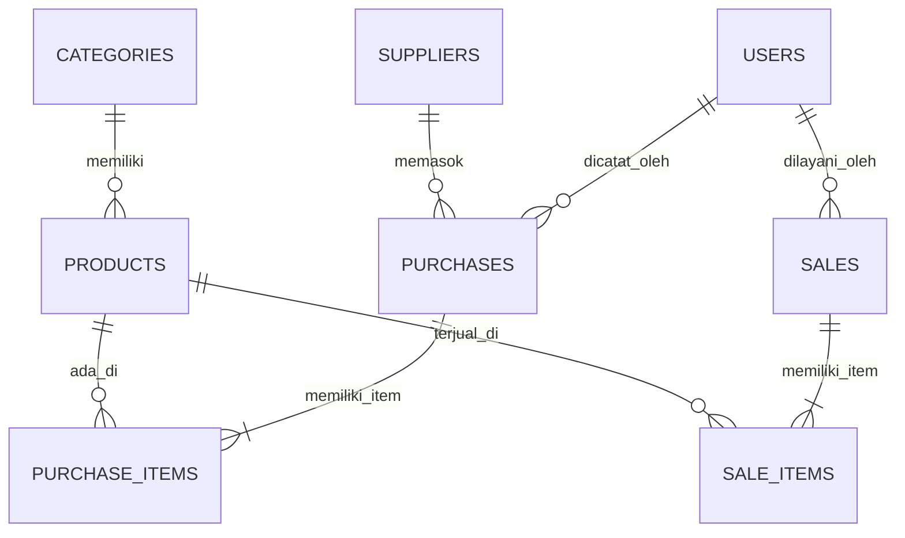

# STENCU COFFEE - INVENTORY & SALES MANAGEMENT SYSTEM
**Ujian Tengah Semester (UTS) Web Programming 2 | Integrated Laravel Project**
*Studi Kasus UMKM: Stencu Coffee – Batuphat Barat, Lhokseumawe, Aceh*

---

## 1. Project Overview
Aplikasi ini adalah sistem bisnis terpadu untuk pengelolaan persediaan bahan baku dan transaksi penjualan pada UMKM **Stencu Coffee** yang berlokasi di Batuphat Barat, Lhokseumawe. Sistem dirancang untuk mengatasi permasalahan pencatatan manual seperti selisih stok, risiko overselling pada pesanan kasir, hilangnya rekam jejak nota pasokan dari petani kopi Gayo, serta lambatnya kalkulasi omset harian.

Sistem menerapkan arsitektur standar **Laravel MVC, Eloquent ORM, MySQL Transactions (`DB::transaction`), Row Locking (`Product::lockForUpdate`), dan Otorisasi Server-Side Multi-Role**.

---

## 2. Requirements Sistem
- **Web Server**: Apache / Nginx (Laragon / XAMPP)
- **PHP**: Versi 8.1 / 8.2 / 8.5
- **Database Engine**: MySQL 8.0 / MariaDB
- **Dependency Manager**: Composer 2.x
- **Browser**: Google Chrome / Microsoft Edge / Mozilla Firefox
- **Framework & CSS**: Laravel 13, Bootstrap 5.3 (via CDN, tidak memerlukan npm compile)

---

## 3. Instalasi Langkah demi Langkah (Reproducible Setup)
Untuk menjalankan project dari clean environment (Slide 21):

```bash
# 1. Masuk ke direktori web server (contoh di Laragon)
cd C:\laragon\www\Stencu

# 2. Salin environment configuration
cp .env.example .env

# 3. Generate application key
php artisan key:generate

# 4. Konfigurasi database di file .env (Pastikan MySQL Laragon aktif):
# DB_CONNECTION=mysql
# DB_HOST=127.0.0.1
# DB_PORT=3306
# DB_DATABASE=stencu_inventory
# DB_USERNAME=root
# DB_PASSWORD=

# 5. Jalankan migrasi dan seeder data realistis
php artisan migrate:fresh --seed

# 6. Jalankan automated tests untuk verifikasi
php artisan test

# 7. Buka aplikasi di browser
# Melalui Laragon: http://localhost/Stencu/public
# Atau via PHP dev server:
php artisan serve
```

---

## 4. Akun Demo Uji Coba (Demo Accounts)
Sistem dilengkapi 3 peran pengguna (*Role-based Access Control*) yang sudah di-seed secara otomatis:

| Role | Email Login | Password | Hak Akses Utama |
| :--- | :--- | :--- | :--- |
| **Owner (Superadmin)** | `owner@stencu.com` | `password123` | Akses penuh: Executive dashboard, CRUD master data, kelola staf, batalkan transaksi & pulihkan stok |
| **Staff (Barista / Kasir)** | `kasir@stencu.com` | `password123` | Akses POS Kasir (jual), catat nota pembelian (stock-in), lihat katalog stok. Dilarang hapus master/kelola role |
| **Customer (Pelanggan)** | `pelanggan@gmail.com` | `password123` | Akses katalog menu publik, keranjang belanja online interaktif, pemesanan mandiri via web (Dine-in meja / Takeaway), cetak nota digital & pelacakan status pesanan |

---

## 5. Entity Relationship Diagram (ERD) & Relasi Eloquent



### Penjelasan Relasi:
- `Category hasMany Product` dan `Product belongsTo Category`: Satu kategori (misal: *Signature Coffee*) memiliki banyak produk menu.
- `Supplier hasMany Purchase` dan `Purchase belongsTo Supplier`: Satu pemasok (misal: *Koperasi Kopi Bener Meriah*) dapat memiliki banyak faktur pembelian.
- `Purchase hasMany PurchaseItem` & `PurchaseItem belongsTo Product`: Faktur pembelian multi-item.
- `Sale hasMany SaleItem` & `SaleItem belongsTo Product`: Satu nota penjualan kasir dapat memuat banyak produk sekaligus.
- **Pencegahan N+1 Query**: Seluruh query relasi pada controller menggunakan *Eager Loading* (contoh: `Product::with('category')->paginate(10)`).

---

## 6. Business Rules & Data Integrity (Aturan Bisnis Kritis)

1. **Kalkulasi Mutlak di Server (`SaleController@store`)**:
   Harga satuan (`unit_price`) dan subtotal diambil langsung dari record database (`$product->selling_price`), bukan mempercayai payload yang dikirim dari browser frontend.
2. **Pencegahan Race Condition & Overselling**:
   Menggunakan `Product::lockForUpdate()` di dalam blok `DB::transaction()`. Jika dua kasir memproses sisa stok terakhir secara bersamaan, transaksi kedua akan mengantre dan ditolak dengan pesan error yang jelas jika stok tidak lagi mencukupi.
3. **Rollback Atomik**:
   Jika salah satu item dalam keranjang pesanan gagal atau melebihi stok, seluruh transaksi di-rollback secara utuh tanpa ada record setengah tersimpan.
4. **Pembatalan Transaksi & Pemulihan Stok (`SaleController@cancel`)**:
   Hanya dapat dilakukan oleh role `owner`. Stok produk yang sebelumnya terjual otomatis dikembalikan (`$product->increment('stock', $item->quantity)`).
5. **Proteksi Riwayat Transaksi (Soft Deletes)**:
   Produk yang sudah memiliki rekam jejak penjualan dilindungi dari *hard delete* fisik agar nota dan laporan masa lalu tidak *corrupt*.

---

## 7. Bukti Pengujian Otomatis (Automated Feature Tests)
Aplikasi telah diuji menggunakan PHPUnit dengan **10 skenario pengujian (100% PASS)**:

```text
 PASS  Tests\Unit\ExampleTest
 ✓ that true is true

 PASS  Tests\Feature\ExampleTest
 ✓ the application returns a successful response

 PASS  Tests\Feature\StencuInventoryTest
 ✓ guest cannot access dashboard and wrong password is rejected
 ✓ duplicate sku and negative price are rejected
 ✓ successful purchase increments product stock
 ✓ successful sale decrements product stock
 ✓ sale with insufficient stock is rejected without data change
 ✓ transaction atomicity and rollback on insufficient item
 ✓ staff cannot access owner admin functions
 ✓ search and filter produce accurate results

Tests:    10 passed (26 assertions)
Duration: 0.94s
```

---

## 8. Contekan Persiapan Wawancara Dosen (Code Ownership Interview)

Berikut adalah panduan menjawab pertanyaan dosen saat demo kode (Slide 24):

1. **Mengapa `Sale` memiliki relasi `hasMany` ke `SaleItem`?**  
   *Jawaban*: Karena satu transaksi penjualan di kasir Stencu Coffee bisa membeli lebih dari satu produk (contoh: 2 Kopi Susu Aren + 1 Croissant). Entitas perantara `SaleItem` menyimpan kuantitas, harga saat dibeli, dan subtotal per item dengan FK `sale_id` dan `product_id`.
2. **Di mana sistem memastikan stok tidak menjadi negatif?**  
   *Jawaban*: Di `SaleController.php` pada method `store()`. Terdapat pengecekan kondisi `if ($qty < 1 || $product->stock < $qty)` sebelum pengurangan stok dilakukan. Ditambah constraint database tipe unsigned integer.
3. **Mengapa total penjualan dihitung di server?**  
   *Jawaban*: Untuk keamanan data (*security integrity*). Jika total dihitung di browser, pengguna bisa memanipulasi angka lewat Inspect Element atau Postman. Server mengambil harga asli dari tabel `products` di database.
4. **Apa risiko jika pengurangan stok dilakukan di luar `DB::transaction`?**  
   *Jawaban*: Inkonsistensi data. Jika server error atau listrik mati di tengah jalan setelah nota dibuat tapi sebelum stok terpotong, stok fisik dan database akan selisih (*partial commit*).
5. **Bagaimana mencegah Staff mengakses fungsi Admin melalui URL langsung?**  
   *Jawaban*: Dilindungi di server-side menggunakan Middleware `EnsureUserRole` (`role:owner`) pada `routes/web.php`. Jika Staff nekat mengetik URL `/users` atau `/products-create`, server langsung menolak dengan status HTTP **403 Forbidden**.
6. **Apa yang terjadi jika dua penjualan memproses produk yang sama hampir bersamaan?**  
   *Jawaban*: `Product::lockForUpdate()` melakukan *exclusive row lock* di level MySQL InnoDB. Transaksi pertama akan memotong stok dan commit terlebih dahulu, baru transaksi kedua memeriksa stok riil yang tersisa.
7. **Tunjukkan validasi SKU unik dan jelaskan peran constraint database!**  
   *Jawaban*: Validasi form di `ProductController@store`: `'sku' => 'required|unique:products,sku'`. Dan di level database migrasi: `$table->string('sku')->unique()`. Constraint database bertindak sebagai benteng pertahanan terakhir agar tidak ada data kembar walau terjadi *concurrency*.
8. **Ubah aturan minimum stock dan tunjukkan dampaknya!**  
   *Jawaban*: Buka file `ProductController.php` atau `Product.php`. Ubah nilai default `$product->minimum_stock = 10`. Dampaknya, produk yang stoknya di bawah 10 akan langsung memicu badge alert kuning dan muncul di widget peringatan dashboard.
