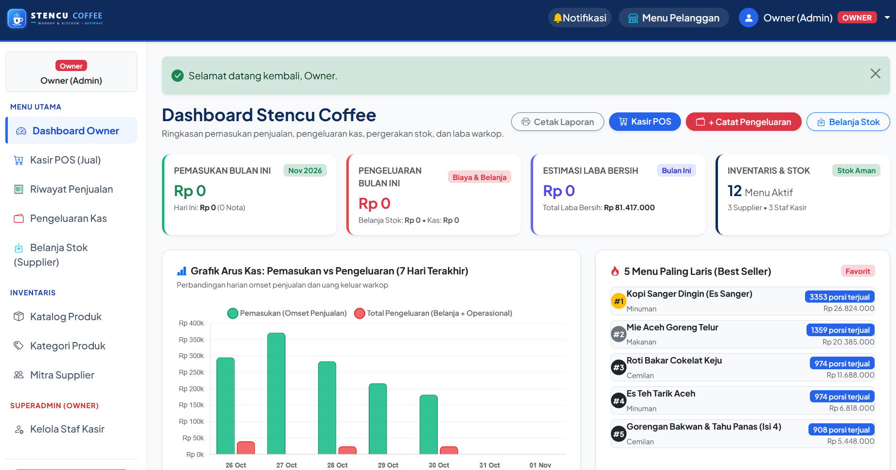
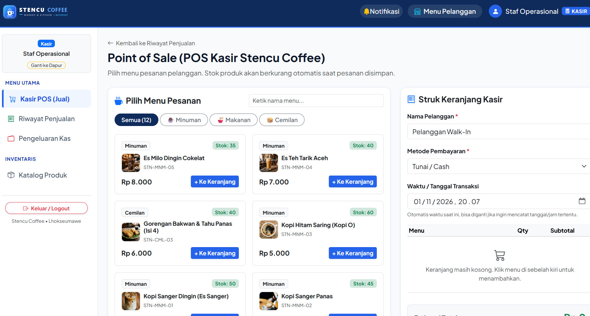
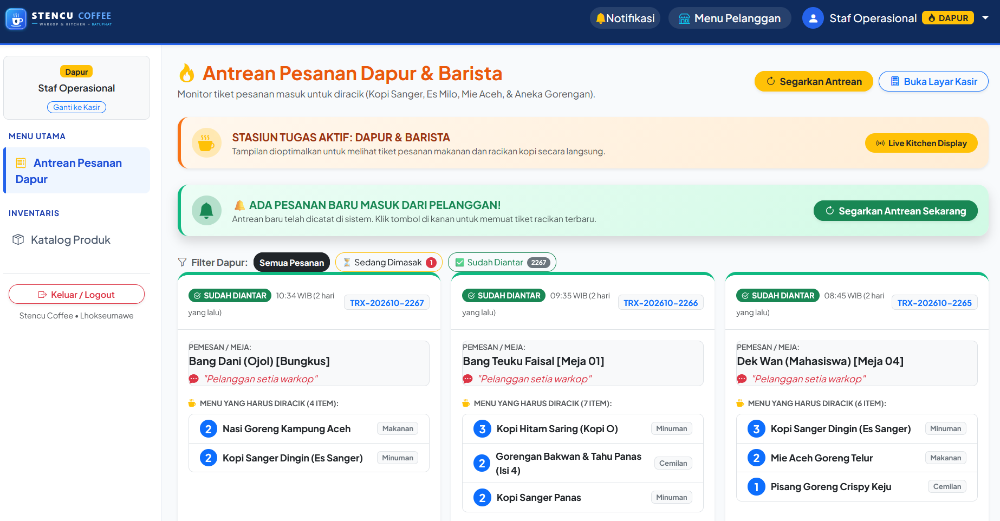
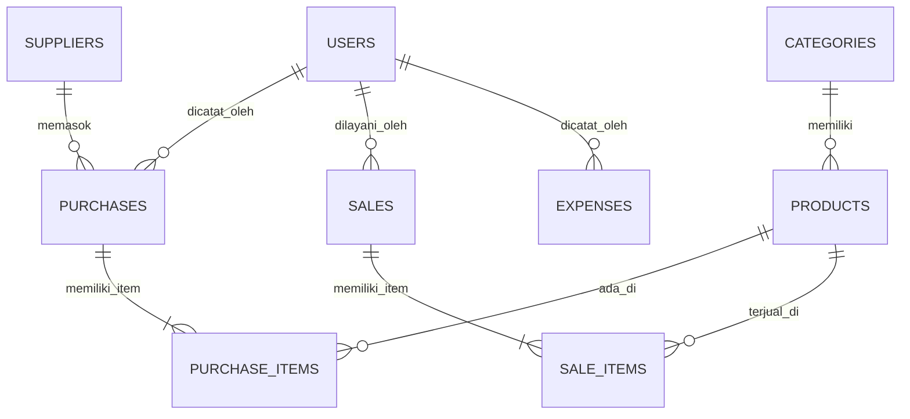

# ☕ STENCU COFFEE - INVENTORY & SALES MANAGEMENT SYSTEM
> **Ujian Tengah Semester (UTS) Web Programming 2 | Integrated Laravel Project**  
> *Studi Kasus UMKM: Stencu Coffee – Batuphat Barat, Muara Satu, Kota Lhokseumawe, Aceh*

---

## 📌 1. Deskripsi Project
Aplikasi ini adalah sistem manajemen operasional bisnis terpadu untuk UMKM warkop **Stencu Coffee** di Lhokseumawe. Sistem dirancang untuk mengatasi permasalahan pencatatan manual seperti selisih stok fisik, risiko *overselling* saat kasir ramai, lambatnya rekapitulasi omset harian, ketiadaan pencatatan pengeluaran operasional kas (*expenses*), serta lambatnya koordinasi antara kasir dan tim racik barista di dapur.

Sistem menerapkan arsitektur standar **Laravel MVC, Eloquent ORM, MySQL Transactions (`DB::transaction`), Row-Level Locking (`Product::lockForUpdate`), Role-based Access Control (Multi-Role Server-side), serta Sistem Notifikasi Realtime**.

---

## 📸 2. Tangkapan Layar Sistem (Screenshots)
> *Cukup simpan 3 screenshot utama ini di dalam folder `docs/screenshots/`:*

| Fitur Utama | Tangkapan Layar | URL di Browser |
| :--- | :--- | :--- |
| **1. Dashboard Owner & Laporan Laba** |  | `http://localhost/Stencu/public/dashboard` |
| **2. Mesin Kasir POS (Penjualan)** |  | `http://localhost/Stencu/public/sales/create` |
| **3. Papan Antrean Dapur & Barista** |  | `http://localhost/Stencu/public/sales` *(Login Dapur)* |

---

## 🔑 3. Akun Pengguna Uji Coba (Demo Accounts)
Sistem memiliki 4 peran pengguna (*Role-based Access Control*) yang sudah diisi secara otomatis ke database:

| Peran (Role) | Email Login | Password | Hak Akses Utama |
| :--- | :--- | :--- | :--- |
| **Owner (Admin)** | `admin@stencu.com` | `password` | Akses penuh: Dashboard eksekutif, analisa omset & laba bersih, batalkan transaksi & pulihkan stok, kelola akun staf & supplier |
| **Kasir** | `kasir@stencu.com` | `password` | Layar Kasir POS (jual), cetak struk nota, catat pengeluaran kas harian, cek stok katalog produk |
| **Dapur & Barista** | `dapur@stencu.com` | `password` | Layar antrean masak (KDS) khusus tiket racikan kopi & makanan, tombol `Tandai Selesai Diantar` |
| **Pelanggan (Customer)** | `pelanggan@gmail.com` | `password` | Akses katalog menu publik mandiri (Scan QR di meja), pelacakan live status pesanan (`/track-order`) |

---

## 🚀 4. Fitur Utama Sistem

1. **Point of Sale (POS) Kasir**:
   - Pencarian menu instan & filter kategori cepat (Minuman, Makanan, Cemilan).
   - Pengurangan stok produk otomatis dan aman dari *race condition* via `Product::lockForUpdate()`.
   - Cetak struk belanja rapi dengan waktu cetak riil statis (format thermal-ready).
2. **Kitchen Display System (KDS) & Audio Chime**:
   - Papan tiket antrean racikan pesanan khusus layar barista dapur.
   - Dilengkapi **nada dering lonceng kafe otomatis (Web Audio API)** saat pesanan baru masuk dari kasir atau scan QR meja.
   - Tombol **`[ ✅ Tandai Selesai Diantar ]`** yang langsung memperbarui status ke meja tamu.
3. **Pencatatan Pengeluaran Kas Operasional (Expenses)**:
   - Pencatatan uang kas keluar warkop untuk operasional (es batu kristal, gas LPG 3kg, galon air, token listrik).
   - Tombol cepat 1-klik (*quick chips*) untuk input pengeluaran rutin harian.
4. **Pembelian Stok Bahan Baku (Stock-In)**:
   - Input faktur pembelian dari mitra supplier lokal (Toko Grosir & Penggilingan Kopi).
   - Menambah stok fisik produk di gudang secara otomatis via `DB::transaction()`.
5. **Dashboard Analitik Owner**:
   - Kartu metrik: Pemasukan Bulan Ini, Total Pengeluaran (Bahan + Kas), Estimasi Laba Bersih, dan Status Stok Kritis.
   - Grafik batang interaktif Chart.js: Tren Pemasukan vs Pengeluaran 7 hari terakhir.
   - Daftar 5 Menu Terlaris (*Top 5 Best Seller*).
6. **Simulasi Realistis 1 Tahun Operasional**:
   - Sistem sudah dilengkapi generator riwayat transaksi 365 hari penuh (2.200+ transaksi penjualan, puluhan nota supplier, dan ratusan pengeluaran kas operasional).

---

## 🗄️ 5. Entity Relationship Diagram (ERD) & Struktur Database



### Relasi Tabel Utama:
- `Category hasMany Product` & `Product belongsTo Category`.
- `Supplier hasMany Purchase` & `Purchase belongsTo Supplier`.
- `Purchase hasMany PurchaseItem` & `PurchaseItem belongsTo Product`.
- `Sale hasMany SaleItem` & `SaleItem belongsTo Product`.
- `User hasMany Expense` & `Expense belongsTo User`.
- **Eager Loading**: Mencegah *N+1 Query Problem* di seluruh controller dengan `with()`.

---

## 🛠️ 6. Persyaratan Sistem & Panduan Instalasi

### Persyaratan:
- **PHP**: Versi 8.2 atau 8.4+
- **Database**: MySQL 8.0 / MariaDB
- **Web Server**: Apache / Nginx (Laragon / XAMPP)
- **Composer**: Versi 2.x

### Langkah Instalasi:
```bash
# 1. Clone repository
git clone https://github.com/USERNAME/REPO-NAME.git
cd REPO-NAME

# 2. Salin konfigurasi environment
cp .env.example .env

# 3. Install dependency composer
composer install

# 4. Generate app key
php artisan key:generate

# 5. Konfigurasi database di file .env:
# DB_CONNECTION=mysql
# DB_HOST=127.0.0.1
# DB_PORT=3306
# DB_DATABASE=stencu_inventory
# DB_USERNAME=root
# DB_PASSWORD=

# 6. Migrasi tabel & isi data seeder 1 tahun penuh
php artisan migrate:fresh --seed

# 7. Jalankan web server (Laragon otomatis buka http://localhost/Stencu/public atau jalankan:)
php artisan serve
```

---

## 🧪 7. Pengujian Otomatis (Automated Feature Testing)
Aplikasi telah melalui pengujian otomatis berbasis PHPUnit dengan **17 skenario pengujian (100% PASS)**:

```bash
php artisan test
```

```text
 PASS  Tests\Unit\ExampleTest
 ✓ that true is true

 PASS  Tests\Feature\ExampleTest
 ✓ the application returns a successful response

 PASS  Tests\Feature\StencuInventoryTest
 ✓ guest cannot access dashboard and wrong password is rejected
 ✓ duplicate sku and negative price are rejected
 ✓ successful purchase increments product stock
 ✓ successful sale decrements product stock
 ✓ sale with insufficient stock is rejected without data change
 ✓ transaction atomicity and rollback on insufficient item
 ✓ staff cannot access owner admin functions
 ✓ search and filter produce accurate results
 ✓ order online from table creates cooking sale
 ✓ customer can track cooking order until served
 ✓ owner can cancel purchase and stock is reduced
 ✓ owner can cancel sale and stock is restored
 ✓ realtime order notification polling returns new sales
 ✓ staff can mark order as served to customer
 ✓ staff or owner can record operational expense
 ✓ only owner can delete expense

Tests:    17 passed (89 assertions)
Duration: 2.68s
```

---

## 🎓 8. Panduan Menjawab Pertanyaan Dosen (Code Ownership Q&A)

1. **Bagaimana sistem memastikan stok tidak bisa menjadi minus saat kasir ramai?**  
   *Jawaban*: Menggunakan `Product::lockForUpdate()` di dalam blok `DB::transaction()` pada `SaleController.php`. Sistem mengunci baris produk di level MySQL InnoDB sehingga kasir kedua harus mengantre hingga transaksi pertama selesai memotong stok. Jika sisa stok tidak cukup, transaksi langsung dibatalkan secara atomik (*rollback*).

2. **Mengapa total tagihan dan subtotal dihitung di server, bukan di browser (frontend)?**  
   *Jawaban*: Untuk keamanan integritas data (*Server-Side Validation*). Jika harga dan total dihitung di browser, angka tersebut rentan dimanipulasi melalui Inspect Element atau tools seperti Postman. Server selalu mengambil harga resmi langsung dari database.

3. **Bagaimana cara kerja notifikasi pesanan realtime antara Kasir dan Dapur?**  
   *Jawaban*: Menggunakan metode *Short-Polling AJAX* yang memeriksa `Sale::where('id', '>', $lastId)` setiap 4 detik. Saat pesanan baru terdeteksi, JavaScript memunculkan toast melayang dan membunyikan Web Audio API chime tanpa ketergantungan library luar.

4. **Bagaimana pembagian hak akses (Role-Based Access Control) diimplementasikan?**  
   *Jawaban*: Diimplementasikan melalui Middleware `EnsureUserRole` pada file `routes/web.php`. Pengguna yang mencoba mengakses rute sensitif di luar wewenangnya (misal: kasir mencoba membuka menu kelola user atau hapus produk) akan langsung diblokir dengan status HTTP `403 Forbidden`.
